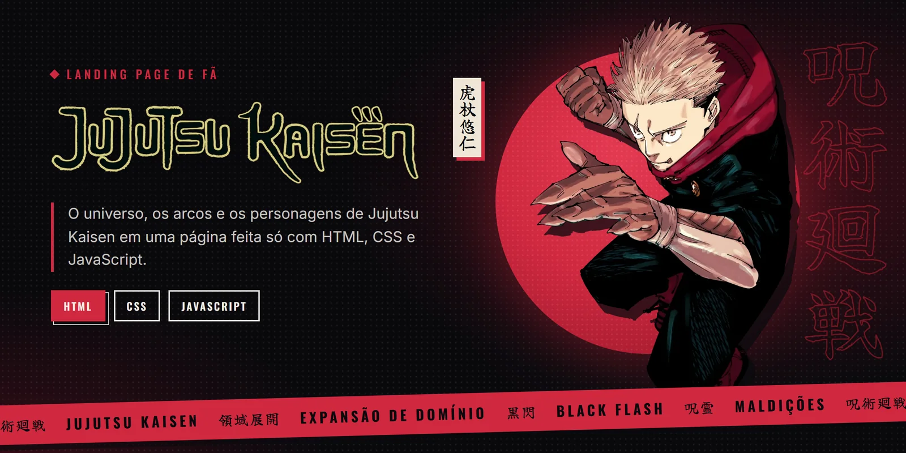
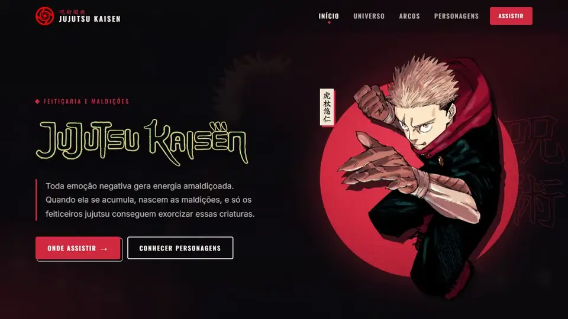
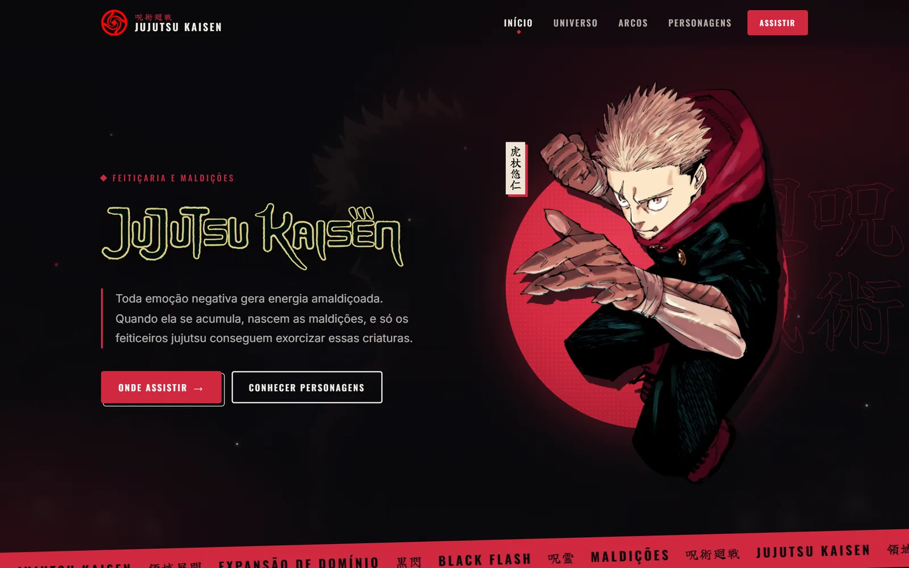
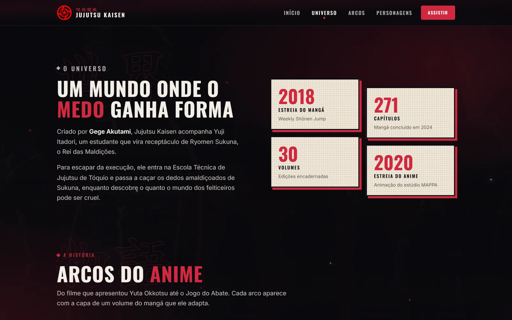
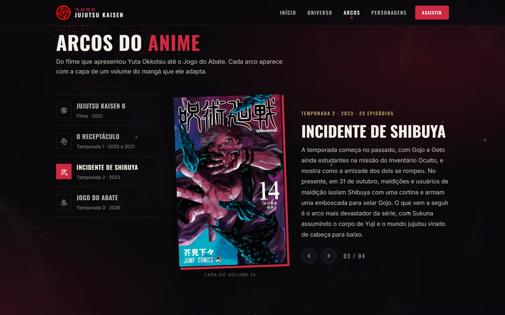
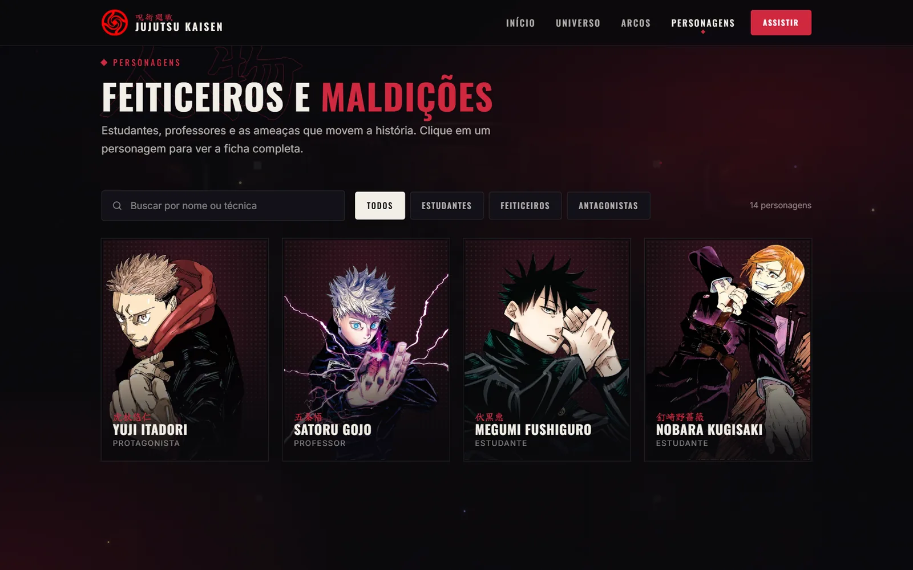
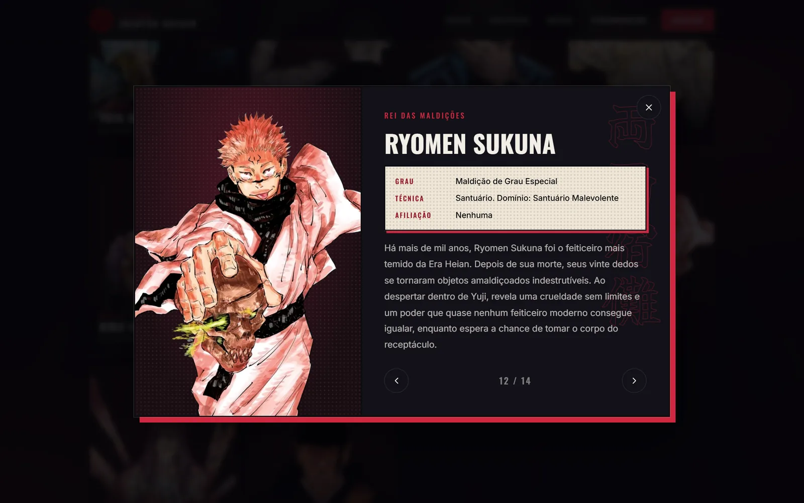
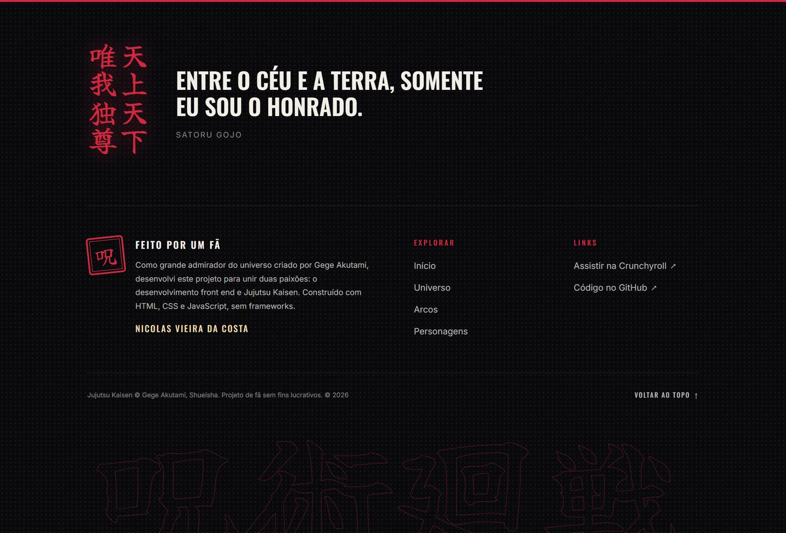
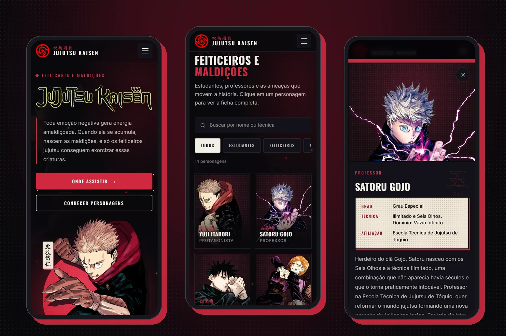

<p align="center">
  
</p>

<h1 align="center">Jujutsu Kaisen · Landing Page</h1>

<p align="center">
  Uma página de fã sobre <strong>Jujutsu Kaisen</strong>, com o visual de um mangá colorido.<br>
  Feita do zero com <strong>HTML, CSS e JavaScript</strong>, sem nenhum framework.
</p>

<p align="center">
  <a href="https://effortless-travesseiro-8838aa.netlify.app/"></a>
  <a href="#-como-rodar-no-seu-computador"></a>
</p>

<p align="center">
  
  
  
  
  
  
</p>

<br>

<p align="center">
  
</p>

<br>

## 📖 Índice

- [Sobre o projeto](#-sobre-o-projeto)
- [Telas](#-telas)
- [Funcionalidades](#-funcionalidades)
- [Identidade visual](#-identidade-visual)
- [Tecnologias](#-tecnologias)
- [Como rodar no seu computador](#-como-rodar-no-seu-computador)
- [Estrutura de pastas](#-estrutura-de-pastas)
- [Como adicionar um personagem](#-como-adicionar-um-personagem)
- [Acessibilidade e desempenho](#-acessibilidade-e-desempenho)
- [O que aprendi](#-o-que-aprendi)
- [Créditos](#-créditos)

<br>

## 🩸 Sobre o projeto

Jujutsu Kaisen é um mangá de **Gege Akutami** que virou um dos animes mais assistidos dos últimos anos. A história acompanha Yuji Itadori, um estudante que engole o dedo de uma maldição e passa a carregar dentro de si o Rei das Maldições, Ryomen Sukuna.

Este projeto é uma **landing page de fã**: uma página única que apresenta esse universo de um jeito visual e fácil de navegar. Ele nasceu como um desafio pessoal para praticar front end, com foco em três coisas:

> 🎨 **Identidade visual forte**, inspirada nas páginas coloridas do mangá<br>
> 🧭 **Experiência fluida**, com navegação simples no computador e no celular<br>
> 🧹 **Código organizado**, em que o conteúdo fica separado da lógica e do visual

<br>

## 🖼 Telas

### Início
A primeira impressão: logo, uma frase sobre o mundo de Jujutsu Kaisen e o Yuji em arte colorida do mangá, sobre um sol vermelho.



<table>
  <tr>
    <td width="50%" valign="top">
      
      <p align="center"><strong>Universo</strong><br><sub>Um resumo da obra e os números principais em painéis cor de papel.</sub></p>
    </td>
    <td width="50%" valign="top">
      
      <p align="center"><strong>Arcos</strong><br><sub>Os quatro arcos do anime, cada um com a capa real de um volume do mangá.</sub></p>
    </td>
  </tr>
  <tr>
    <td width="50%" valign="top">
      
      <p align="center"><strong>Personagens</strong><br><sub>14 personagens com busca por nome ou técnica e filtro por categoria.</sub></p>
    </td>
    <td width="50%" valign="top">
      
      <p align="center"><strong>Ficha do personagem</strong><br><sub>Grau, técnica, afiliação e história. Dá para navegar entre fichas pelas setas.</sub></p>
    </td>
  </tr>
</table>

### Rodapé
Uma citação marcante do Gojo, um carimbo no estilo japonês e os créditos do projeto.



### No celular
Todo o layout se adapta a telas pequenas. A ficha do personagem vira uma folha que sobe da parte de baixo da tela e pode ser trocada com um deslize do dedo.

<p align="center">
  
</p>

<br>

## ✨ Funcionalidades

| Recurso | O que faz |
|---|---|
| 🧭 **Menu inteligente** | Destaca automaticamente a seção que está na tela e vira um menu sanfona no celular. |
| 📚 **Arcos em abas** | Troca entre os arcos com clique, com as setas do teclado ou com os botões de anterior e próximo. |
| 🔎 **Busca de personagens** | Encontra por nome, técnica ou afiliação, sem precisar acertar acentos ou maiúsculas. |
| 🏷 **Filtros** | Mostra só Estudantes, Feiticeiros ou Antagonistas, com contador de resultados. |
| 🪪 **Ficha completa** | Abre os detalhes do personagem em uma janela. Fecha com `Esc` ou clicando fora. |
| 🔗 **Link direto** | Cada ficha tem seu próprio endereço. Exemplo: `#personagem-sukuna` abre a ficha do Sukuna. |
| 👆 **Gestos no celular** | Deslize para os lados dentro da ficha para ir ao próximo personagem. |
| 🎬 **Vídeo de fundo** | Um vídeo discreto que pausa sozinho quando a aba não está visível, para poupar bateria. |
| ⏳ **Tela de carregamento** | Aparece só na primeira visita e nunca prende o usuário por muito tempo. |
| 👉 **Cursor temático** | No computador, o cursor vira o dedo amaldiçoado do Sukuna. |
| 🚫 **Página 404** | Uma página de erro com o tema do site para endereços que não existem. |

<br>

## 🎨 Identidade visual

O visual foi pensado para lembrar **uma página de mangá colorida**: tinta preta, papel envelhecido e o vermelho da energia amaldiçoada.

<table>
  <tr>
    <td align="center"><br><sub><b>Tinta</b><br><code>#0a090d</code></sub></td>
    <td align="center"><br><sub><b>Energia amaldiçoada</b><br><code>#d0283f</code></sub></td>
    <td align="center"><br><sub><b>Papel</b><br><code>#efe6d6</code></sub></td>
    <td align="center"><br><sub><b>Ouro</b><br><code>#c9a961</code></sub></td>
  </tr>
</table>

- **Arte oficial do mangá colorido** em todas as imagens de personagem, sempre no mesmo padrão e sem fundo.
- **Retícula** (os pontinhos típicos de mangá) aplicada nos fundos dos painéis.
- **Sombras deslocadas em vermelho**, como se cada painel fosse um quadro impresso.
- **Kanji em pincel** como decoração: 世界 (mundo), 物語 (história) e 人物 (personagens) atrás de cada título.
- **Tipografia:** [Oswald](https://fonts.google.com/specimen/Oswald) nos títulos, [Inter](https://fonts.google.com/specimen/Inter) nos textos e [Yuji Syuku](https://fonts.google.com/specimen/Yuji+Syuku) nos caracteres japoneses.

<br>

## 🛠 Tecnologias

| | Tecnologia | Para que foi usada |
|:---:|---|---|
|  | **HTML5** | Estrutura da página com elementos semânticos como `header`, `nav`, `main`, `dialog` e `footer`. |
|  | **CSS3** | Todo o visual: variáveis de cor, Grid, Flexbox, animações e texto vertical japonês com `writing-mode`. |
|  | **JavaScript** | Interações: abas, busca, filtros, ficha, menu e animações ao rolar a página. |
|  | **Figma** | Rascunho do layout e protótipo inicial. |
|  | **Netlify** | Publicação do site na internet. |

> 💡 **Por que sem frameworks?** A ideia foi treinar a base. Tudo o que um framework faria por baixo dos panos, como montar a lista de personagens a partir dos dados, foi escrito à mão.

<br>

## 💻 Como rodar no seu computador

Você só precisa do [Git](https://git-scm.com/) e de um navegador. Não é preciso instalar nenhuma dependência.

**1. Baixe o projeto**

```bash
git clone https://github.com/Nickvtj/Jujutsu-Kaisen-Landing-Page.git
cd Jujutsu-Kaisen-Landing-Page
```

**2. Abra com um servidor local** (escolha uma opção)

| Opção | Como fazer |
|---|---|
| **VS Code** | Instale a extensão **Live Server**, clique com o botão direito no `index.html` e escolha *Open with Live Server*. |
| **Python** | Rode `python -m http.server 8000` e acesse `http://localhost:8000`. |
| **Node.js** | Rode `npx serve` e acesse o endereço que aparecer no terminal. |

> ⚠️ Abrir o `index.html` com dois cliques até funciona, mas um servidor local garante que o vídeo e todas as imagens carreguem do jeito certo.

<br>

## 🗂 Estrutura de pastas

```
📁 Jujutsu-Kaisen-Landing-Page
├── 📄 index.html              Página única com todas as seções
├── 📄 404.html                Página de erro
├── 📁 css
│   └── style.css              Todo o visual do site
├── 📁 js
│   ├── main.js                Carregamento, menu, vídeo e animações
│   ├── arcos.js               Abas dos arcos
│   └── personagens.js         Grade, busca, filtros e ficha
├── 📁 data
│   ├── personagens.js         Textos e imagens dos personagens
│   └── arcos.js               Textos e capas dos arcos
├── 📁 assets
│   ├── img/personagens        Arte de cada personagem
│   ├── img/capas              Capas dos volumes do mangá
│   └── media                  Vídeo de fundo
└── 📁 docs/readme             Imagens deste README
```

O conteúdo fica em `data/`, separado do código. Assim, dá para mudar um texto ou incluir um personagem sem mexer na lógica da página.

<br>

## ➕ Como adicionar um personagem

1. Coloque a imagem do personagem em `assets/img/personagens/` (formato retrato, proporção 3:4).
2. Abra `data/personagens.js` e adicione um bloco como este no final da lista:

```js
{
    slug: 'nome-do-personagem',        // usado no link direto: #personagem-nome-do-personagem
    nome: 'Nome do Personagem',
    kanji: '名前',                     // nome em japonês (aparece em vermelho no card)
    papel: 'Estudante',
    categoria: 'estudante',            // estudante, feiticeiro ou antagonista
    grau: 'Grau 1',
    tecnica: 'Nome da técnica',
    afiliacao: 'Escola Técnica de Jujutsu de Tóquio',
    descricao: 'Uma frase curta.',
    historia: 'O texto completo que aparece na ficha.',
    imagem: 'assets/img/personagens/nome-do-personagem.webp',
},
```

3. Salve e recarregue a página. O card, a busca, o filtro e a ficha passam a incluir o novo personagem sozinhos.

<br>

## ♿ Acessibilidade e desempenho

<table>
  <tr>
    <td width="50%" valign="top">

**Acessibilidade**
- Tudo funciona só com o teclado, incluindo abas, filtros e ficha
- Link "Pular para o conteúdo" para quem navega pelo teclado
- Textos alternativos em todas as imagens
- Respeita quem prefere menos movimento: animações e vídeo param automaticamente
- O foco volta para o card certo quando a ficha fecha

</td>
    <td width="50%" valign="top">

**Desempenho**
- Imagens no formato **WebP**, bem mais leve que PNG
- Vídeo de fundo comprimido de **25 MB para cerca de 4 MB**
- Imagens dos personagens só carregam quando chegam perto da tela
- Vídeo pausa quando a aba fica em segundo plano
- Nenhuma biblioteca externa de JavaScript

</td>
  </tr>
</table>

<br>

## 🧠 O que aprendi

- [x] Organizar um projeto separando **conteúdo, visual e comportamento**
- [x] Criar uma **identidade visual** própria e usar ela com consistência
- [x] Construir componentes **acessíveis** de verdade, como abas e janelas
- [x] Deixar o layout **responsivo** sem perder a personalidade no celular
- [x] **Otimizar** imagens e vídeo para o site carregar rápido
- [x] Usar recursos modernos do navegador, como `<dialog>` e `IntersectionObserver`

<br>

## 🙏 Créditos

- **Jujutsu Kaisen** © Gege Akutami, Shueisha. Personagens, artes e capas pertencem aos seus autores e foram usados apenas para fins de estudo.
- Artes coloridas do mangá reunidas pelo [Jujutsu Kaisen Wiki](https://jujutsu-kaisen.fandom.com/).
- Projeto inspirado no [Frontweek Hollow Knight](https://frontweek-hollowknight.netlify.app/).

> Este é um **projeto de fã, sem fins lucrativos** e sem ligação oficial com a obra ou seus detentores de direitos.

<br>

---

<p align="center">
  Feito com 🩸 por <a href="https://github.com/Nickvtj"><strong>Nicolas Vieira da Costa</strong></a>
  <br>
  <sub>Se o projeto te ajudou ou te inspirou, deixe uma ⭐ no repositório!</sub>
</p>
